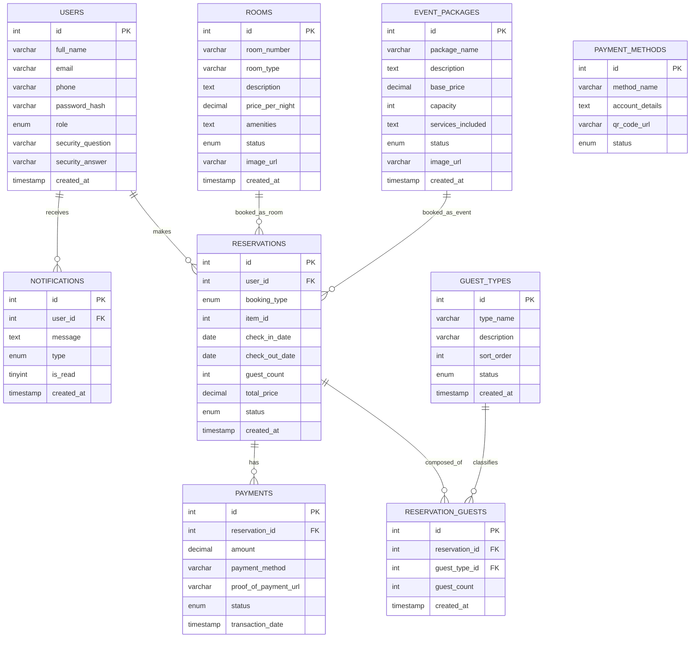

<div align="center">

# 🏨 Centrotel & Event Center — Online Reservation System

**A full-stack web-based reservation and management system for a hotel and event venue located in Tuao, Cagayan Valley, Philippines.**

[](https://www.php.net/)
[](https://www.mysql.com/)
[](https://getbootstrap.com/)
[](https://developer.mozilla.org/en-US/docs/Web/JavaScript)

</div>

---

## 📋 Table of Contents

- [Overview](#-overview)
- [Features](#-features)
- [System Architecture](#-system-architecture)
- [Technology Stack](#-technology-stack)
- [Database Design](#-database-design)
- [Project Structure](#-project-structure)
- [Installation & Setup](#-installation--setup)
- [Usage Guide](#-usage-guide)
- [API Endpoints](#-api-endpoints)
- [Security Features](#-security-features)
- [Screenshots](#-screenshots)
- [Developer](#-developer)

---

## 🌟 Overview

The **Centrotel & Event Center Online Reservation System** is a comprehensive web application built to digitize and streamline the full booking lifecycle for a hospitality business — from customer self-service browsing and reservation submission, to administrative approval workflows, payment tracking, and financial reporting.

The system serves two distinct user roles:

| Role | Portal | Access |
|---|---|---|
| **Customer** | Public-facing website (`index.php`) | Browse rooms & event packages, make reservations, upload payment proofs, track booking status, write reviews |
| **Administrator** | Private admin panel (`/admin`) | Manage inventory, approve/reject bookings, verify payments, handle customer records, generate financial reports |

---

## ✨ Features

### 👤 Customer Portal

| Feature | Description |
|---|---|
| **Account Registration** | Multi-step sign-up with OTP verification via SMS (Globe/TM) or Email |
| **Secure Authentication** | Login with password strength enforcement, show/hide toggle, and CSRF protection |
| **Password Recovery** | Multi-channel OTP-based password reset (SMS or Email) with a guided 4-step flow |
| **Room Browsing** | Browse available Airbnb-style rooms with swipeable multi-photo carousels, amenities lists, and star ratings |
| **Event Package Browsing** | Explore event packages with capacity info, services included, gallery images, and community reviews |
| **Online Reservation** | Book rooms (nightly stay) or event packages with a date picker, guest-type breakdown (Male/Female/Children), and real-time conflict detection |
| **Payment Submission** | Upload payment proof linked to a specific reservation with support for multiple payment methods (GCash, bank transfer, etc.) |
| **My Reservations** | View the full history of all personal bookings with status tracking (Pending → Approved → Completed) |
| **Real-time Notifications** | In-app notification bell with live polling for booking status updates sent by the admin |
| **Review & Rating** | Submit star ratings and written feedback for completed room stays or events; displays community-approved reviews publicly |
| **Profile Management** | Update personal information and change password from within the portal |

### 🔧 Admin Panel

| Feature | Description |
|---|---|
| **Dashboard** | Live statistics cards (Total Reservations, Revenue, Pending Approvals, Available Rooms) with real-time auto-refresh polling every 10 seconds |
| **Room Management** | Full CRUD for room listings — add/edit/delete rooms, manage multiple gallery images, set room status (Available / Occupied / Maintenance) |
| **Event Package Management** | Full CRUD for event packages — manage pricing, capacity, services included, and swipeable image galleries |
| **Booking Management** | View all reservations, filter by status/type/date, approve or reject bookings, view detailed payment proofs, add internal notes, and send customer notifications |
| **Review Moderation** | Approve or reject customer reviews before they appear publicly on the customer portal |
| **Customer Management** | View all registered customer accounts with their booking histories and contact information |
| **Guest Type Management** | Configure and manage guest categories (e.g., Male, Female, Children) used in the booking composition breakdown |
| **Payment Settings** | Configure and manage accepted payment methods with account details and QR codes |
| **Financial Reports** | Filterable revenue reports by Day / Week / Month / Annual with breakdown tables, revenue-by-category analysis, guest composition statistics, and full transaction history |
| **PDF Export** | Generate and download official financial report PDFs with custom signatory fields (Prepared By / Approved By) |
| **Real-time Toast Notifications** | Browser toast alerts for new customer bookings or events as they happen |

---

## 🏛️ System Architecture

The application follows a traditional **MVC-inspired monolithic PHP architecture** deployed on a standard LAMP/XAMPP stack.

```
┌─────────────────────────────────────────────────────────┐
│                    Customer Browser                      │
│              (Public-facing: index.php)                  │
└──────────────┬──────────────────────────────────────────┘
               │ HTTP Requests
┌──────────────▼──────────────────────────────────────────┐
│                  PHP Application Layer                    │
│  ┌────────────┐  ┌────────────┐  ┌────────────────────┐ │
│  │  index.php │  │  /admin/*  │  │     /api/*.php     │ │
│  │ (Customer  │  │  (Admin    │  │  (AJAX Endpoints)  │ │
│  │  Portal)   │  │  Panel)    │  │                    │ │
│  └─────┬──────┘  └─────┬──────┘  └─────────┬──────────┘ │
│        └─────────┬─────┘                   │            │
│  ┌───────────────▼─────────────────────────▼──────────┐ │
│  │               config/db.php (PDO)                  │ │
│  │          config/sms_helper.php (PhilSMS)           │ │
│  │         config/email_helper.php (PHPMailer)        │ │
│  └───────────────────────┬────────────────────────────┘ │
└──────────────────────────┼──────────────────────────────┘
                           │ PDO / SQL
┌──────────────────────────▼──────────────────────────────┐
│                    MySQL Database                         │
│           (centrotel_db — 9 relational tables)           │
└─────────────────────────────────────────────────────────┘
```

**Key design decisions:**
- **Single-page customer portal** — all sections (Rooms, Events, Modals) rendered server-side in `index.php` and enriched with AJAX for real-time interactions, reducing page load transitions.
- **Polling-based real-time updates** — Admin dashboard and notification bell poll `/api/` endpoints every 10 seconds to reflect new bookings without requiring WebSockets.
- **CSRF protection** — All state-changing forms include a server-generated CSRF token validated on submission.
- **OTP verification** — Account registration and password recovery require a 6-digit code delivered via SMS (PhilSMS API) or Email (SMTP/PHPMailer) to verify user identity.

---

## 🛠️ Technology Stack

| Layer | Technology |
|---|---|
| **Backend** | PHP 8.x (procedural + PDO) |
| **Database** | MySQL 8.x |
| **Frontend** | HTML5, Vanilla CSS, Vanilla JavaScript (ES6+) |
| **CSS Framework** | Bootstrap 5.3 |
| **Icons** | Font Awesome 6.4 |
| **Typography** | Google Fonts — Inter, Outfit |
| **Date Picker** | Flatpickr |
| **Charts** | Chart.js |
| **PDF Generation** | Custom PHP PDF renderer (`export_financial_pdf.php`) |
| **SMS Gateway** | PhilSMS API |
| **Email** | PHPMailer (SMTP) |
| **Local Server** | XAMPP (Apache + MySQL + PHP) |

---

## 🗄️ Database Design

The system uses **9 relational tables** in a normalized MySQL schema.

### Entity-Relationship Diagram



> **Note:** `RESERVATIONS.item_id` is a logical polymorphic key — it points to `rooms.id` when `booking_type = 'room'` and `event_packages.id` when `booking_type = 'event'`.

---

## 📁 Project Structure

```
centrotel/
│
├── index.php                   # Main customer portal (SPA-style single file)
├── admin_login.php             # Separate admin authentication page
├── review.php                  # Public review submission page
├── database.sql                # Full database schema and seed data
│
├── admin/                      # Admin panel pages
│   ├── dashboard.php           # Live stats + recent bookings overview
│   ├── rooms.php               # Room CRUD + image gallery management
│   ├── packages.php            # Event package CRUD + image management
│   ├── reservations.php        # Full booking management + approval workflow
│   ├── reviews.php             # Review moderation (approve / reject)
│   ├── users.php               # Customer account viewer
│   ├── guest_types.php         # Guest category management
│   ├── payment_settings.php    # Payment method configuration
│   ├── reports.php             # Filterable financial reports
│   └── export_financial_pdf.php # PDF report generator
│
├── api/                        # AJAX/RESTful JSON endpoints
│   ├── make_reservation.php    # Submit new reservation
│   ├── upload_payment.php      # Upload payment proof
│   ├── cancel_reservation.php  # Customer-initiated cancellation
│   ├── get_booked_dates.php    # Fetch unavailable dates for a room
│   ├── get_reservations.php    # Fetch customer's reservation list
│   ├── get_reservation_detail.php # Fetch single reservation detail
│   ├── get_admin_reservations.php # Admin: fetch all reservations (paginated)
│   ├── get_admin_stats.php     # Admin: fetch live dashboard stats
│   ├── get_notifications.php   # Polling endpoint for real-time notifications
│   ├── get_customer_detail.php # Fetch a customer's profile details
│   ├── admin_action.php        # Admin: approve/reject/update bookings
│   ├── update_profile.php      # Update customer profile
│   └── download_qr.php         # Serve payment QR code image download
│
├── auth/                       # Authentication handlers
│   ├── login.php               # Login processor
│   ├── register.php            # Registration + OTP send
│   ├── verify_otp.php          # OTP verification
│   ├── forgot_password.php     # Password reset flow
│   └── logout.php              # Session termination
│
├── config/                     # Application configuration
│   ├── db.php                  # PDO database connection
│   ├── sms_helper.php          # PhilSMS API integration
│   ├── email_helper.php        # PHPMailer SMTP integration
│   └── validators.php          # Server-side input validation helpers
│
├── assets/
│   ├── css/
│   │   └── style.css           # Custom global stylesheet
│   └── img/                    # Static images (logos, placeholders)
│
└── uploads/                    # User-uploaded files (payment proofs, room images)
```

---

## ⚙️ Installation & Setup

### Prerequisites

- **XAMPP** (or any Apache + PHP + MySQL stack) with PHP ≥ 8.0
- **MySQL** 8.x
- A **PhilSMS** account API key (for SMS OTP)
- An **SMTP email account** (Gmail App Password or equivalent) for email OTP

### Step 1 — Clone the Repository

```bash
git clone https://github.com/Jeamarienewbie/Centrotel.git
```

Place the `centrotel/` folder inside your web server's document root:
- **XAMPP (Windows):** `C:\xampp\htdocs\centrotel`
- **XAMPP (Linux/macOS):** `/opt/lampp/htdocs/centrotel`

### Step 2 — Create the Database

1. Start **Apache** and **MySQL** in the XAMPP Control Panel.
2. Open **phpMyAdmin** at `http://localhost/phpmyadmin`.
3. Create a new database named `centrotel_db`.
4. Select the database and import the schema:
   - Click **Import** → Choose file → select `database.sql` → click **Go**.

### Step 3 — Add Your Credentials

All secrets live in one file that is **never committed**: `config/secrets.local.php`.

```bash
cp config/secrets.example.php config/secrets.local.php
```

Then fill in the values:

```php
return [
    'sms_token'      => 'YOUR_PHILSMS_API_TOKEN',        // PhilSMS
    'smtp_user'      => 'your_email@gmail.com',          // SMTP / Gmail app password
    'smtp_pass'      => 'your_app_password',
    'db_host_remote' => '',                              // only for live hosting
    'db_name_remote' => '',
    'db_user_remote' => '',
    'db_pass_remote' => '',
];
```

Local development connects to `centrotel_db` on `localhost` as `root` with no
password automatically (see `config/db.php`), so no edit is needed there.

### Step 4 — Set Folder Permissions

Ensure the `uploads/` directory is writable by the web server:

```bash
# Linux/macOS
chmod -R 775 uploads/
```

On Windows with XAMPP, this is typically not required.

### Step 5 — Launch the Application

Open your browser and navigate to:

```
http://localhost/centrotel/
```

The **customer portal** loads immediately. To access the **admin panel**, go to:

```
http://localhost/centrotel/admin_login.php
```

> **Default Admin Credentials:** Set up your admin account by inserting a row with `role = 'admin'` directly into the `users` table via phpMyAdmin, or modify `fix_admin.php` temporarily.

---

## 📖 Usage Guide

### Customer Workflow

```
1. Register → Verify via OTP (SMS or Email)
        ↓
2. Browse Rooms or Event Packages
        ↓
3. Click "View Details" → Review amenities, photos, and ratings
        ↓
4. Click "Book Now" → Fill in dates, guest count and breakdown
        ↓
5. Submit Reservation (status: Pending Approval)
        ↓
6. Upload Payment Proof (down payment ≥ 30%)
        ↓
7. Await Admin Approval → Receive notification
        ↓
8. After stay → Submit a review and rating
```

### Admin Workflow

```
1. Login to Admin Panel (admin_login.php)
        ↓
2. Dashboard → Monitor live stats & recent bookings
        ↓
3. Bookings → Review pending reservations
        ↓
4. View payment proof → Approve or Reject with a note
        ↓
5. Notification sent automatically to customer
        ↓
6. Financial Reports → Filter by period → Export PDF
```

---

## 🔌 API Endpoints

All endpoints return JSON and are located under `/api/`.

| Endpoint | Method | Description | Auth Required |
|---|---|---|---|
| `make_reservation.php` | `POST` | Submit a new room or event reservation | Customer |
| `upload_payment.php` | `POST` | Upload a payment proof image | Customer |
| `cancel_reservation.php` | `POST` | Cancel a pending reservation | Customer |
| `get_booked_dates.php` | `GET` | Fetch unavailable date ranges for a room | Public |
| `get_reservations.php` | `GET` | Fetch current customer's reservations | Customer |
| `get_reservation_detail.php` | `GET` | Fetch full details of a single reservation | Customer |
| `get_notifications.php` | `GET` | Poll for new notifications (uses `last_id`) | Customer/Admin |
| `get_admin_reservations.php` | `GET` | Paginated list of all reservations | Admin |
| `get_admin_stats.php` | `GET` | Live dashboard stat counts | Admin |
| `get_customer_detail.php` | `GET` | Fetch a specific customer's profile | Admin |
| `admin_action.php` | `POST` | Approve / reject / update a booking | Admin |
| `update_profile.php` | `POST` | Update logged-in user's profile details | Customer |
| `download_qr.php` | `GET` | Serve a payment method QR code for download | Admin |

---

## 🔒 Security Features

- **CSRF Token Protection** — All state-changing forms (login, register, reservation, payment) include a session-bound CSRF token validated server-side.
- **OTP Verification** — Account creation and password reset require verification via a time-limited 6-digit OTP sent to the user's registered phone or email.
- **Password Strength Enforcement** — Registration enforces a minimum password complexity (uppercase, lowercase, number, special character) with a real-time strength indicator.
- **PDO Prepared Statements** — All database queries use parameterized prepared statements to prevent SQL injection.
- **Role-Based Access Control (RBAC)** — Admin pages validate the `user_role = 'admin'` session variable on every request and redirect unauthorized users.
- **Input Sanitization** — All user-supplied data is sanitized with `htmlspecialchars()` on output and validated server-side through `config/validators.php`.
- **Secure File Uploads** — Uploaded payment proof files are validated for MIME type and stored outside of the web-accessible root where possible.

---

## 👩‍💻 Developer

**Jeamarie Ocaso**
— *Full-Stack Web Developer (Capstone Project)*

> This system was developed as a capstone/portfolio project to demonstrate proficiency in full-stack PHP web development, relational database design, RESTful API construction, and real-world business process digitization for the hospitality industry.

---

<div align="center">

**© 2026 Centrotel & Event Center. All Rights Reserved.**

*Built with ❤️ using PHP, MySQL & Bootstrap*

</div>
