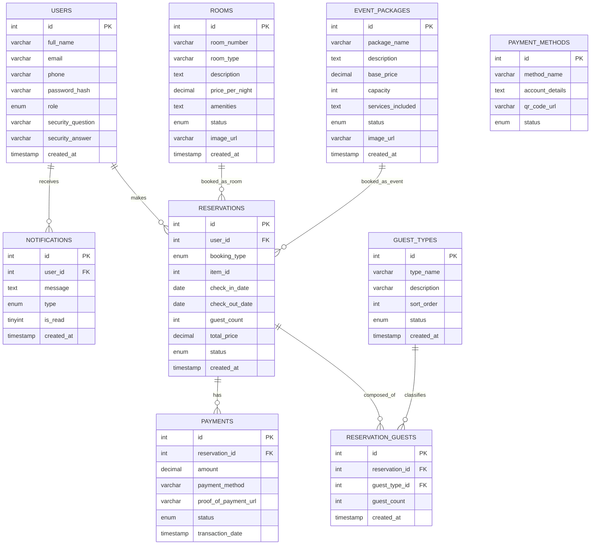
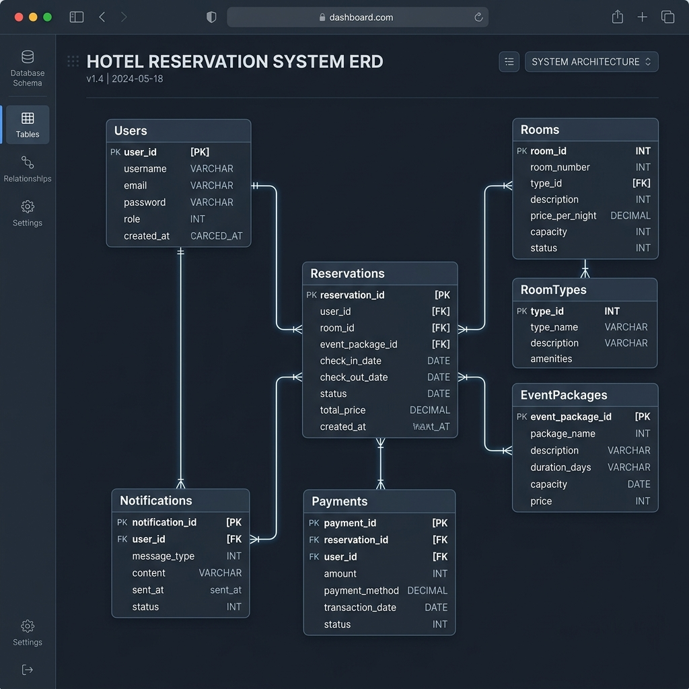

# Centrotel Reservation System: Database Design & Data Dictionary

This document details the database architecture of the **Centrotel Reservation System**. It contains the visual database entity-relationship design and a comprehensive data dictionary specifying the attributes, data types, constraints, and roles for each column in the schema.

---

## 1. Database Design (Entity-Relationship Diagram)

The following diagram illustrates the relationship structure between the tables in the Centrotel Reservation System. 

> [!NOTE]
> The relationship between **ROOMS / EVENT_PACKAGES** and **RESERVATIONS** is a logical polymorphic association. The `item_id` column in standard application logic points to `rooms.id` when `booking_type` equals `'room'` and `event_packages.id` when `booking_type` equals `'event'`.

### Visual Diagram View

---

## 2. Data Dictionary

The tables below define each database relation in detail, including column properties, lengths, and constraints.

### users
Stores user accounts for both system administrators and customers.

| Field | Data type | Length |
| :--- | :--- | :--- |
| **id** | Int | Auto-Increment |
| **full_name** | Varchar | 100 |
| **email** | Varchar | 100 (Unique) |
| **phone** | Varchar | 20 (Unique) |
| **password_hash** | Varchar | 255 |
| **role** | Enum | 'admin', 'customer' (Default: 'customer') |
| **security_question** | Varchar | 255 (Nullable) |
| **security_answer** | Varchar | 255 (Nullable) |
| **created_at** | Timestamp | CURRENT_TIMESTAMP |

### notifications
Stores system notifications pushed to users.

| Field | Data type | Length |
| :--- | :--- | :--- |
| **id** | Int | Auto-Increment |
| **user_id** | Int | 11 (Foreign Key $\rightarrow$ `users.id`) |
| **message** | Text | N/A |
| **type** | Enum | 'info', 'success', 'warning', 'danger' (Default: 'info') |
| **is_read** | Tinyint | 1 (Default: 0) |
| **created_at** | Timestamp | CURRENT_TIMESTAMP |

### rooms
Stores details of available accommodations at Centrotel.

| Field | Data type | Length |
| :--- | :--- | :--- |
| **id** | Int | Auto-Increment |
| **room_number** | Varchar | 10 (Unique) |
| **room_type** | Varchar | 50 |
| **description** | Text | N/A |
| **price_per_night** | Decimal | 10,2 |
| **amenities** | Text | N/A (Comma-separated or JSON) |
| **status** | Enum | 'available', 'occupied', 'maintenance' (Default: 'available') |
| **image_url** | Varchar | 255 (Nullable) |
| **created_at** | Timestamp | CURRENT_TIMESTAMP |

### event_packages
Stores event packages offered for booking (such as ballroom functions, parties, etc.).

| Field | Data type | Length |
| :--- | :--- | :--- |
| **id** | Int | Auto-Increment |
| **package_name** | Varchar | 100 |
| **description** | Text | N/A |
| **base_price** | Decimal | 10,2 |
| **capacity** | Int | 11 |
| **services_included** | Text | N/A (Comma-separated or JSON) |
| **status** | Enum | 'active', 'inactive' (Default: 'active') |
| **image_url** | Varchar | 255 (Nullable) |
| **created_at** | Timestamp | CURRENT_TIMESTAMP |

### reservations
Stores customer booking requests for either room stays or events.

| Field | Data type | Length |
| :--- | :--- | :--- |
| **id** | Int | Auto-Increment |
| **user_id** | Int | 11 (Foreign Key $\rightarrow$ `users.id`) |
| **booking_type** | Enum | 'room', 'event' |
| **item_id** | Int | 11 (Logical Polymorphic Key $\rightarrow$ `rooms.id` / `event_packages.id`) |
| **check_in_date** | Date | N/A |
| **check_out_date** | Date | N/A (Nullable for single-day event bookings) |
| **guest_count** | Int | 11 (Total pax — always equals the sum of the `reservation_guests` breakdown) |
| **total_price** | Decimal | 10,2 |
| **status** | Enum | 'Pending Approval', 'Approved', 'Rejected', 'Completed', 'Cancelled' (Default: 'Pending Approval') |
| **created_at** | Timestamp | CURRENT_TIMESTAMP |

### reservation_guests
Stores the **guest composition** of each reservation — how many guests fall into each admin-managed guest type (e.g. Male, Female, Children). The row total always equals `reservations.guest_count`.

| Field | Data type | Length |
| :--- | :--- | :--- |
| **id** | Int | Auto-Increment |
| **reservation_id** | Int | 11 (Foreign Key $\rightarrow$ `reservations.id`, ON DELETE CASCADE) |
| **guest_type_id** | Int | 11 (Foreign Key $\rightarrow$ `guest_types.id`, ON DELETE CASCADE) |
| **guest_count** | Int | 11 (Default: 0) |
| **created_at** | Timestamp | CURRENT_TIMESTAMP |

> Unique key on (`reservation_id`, `guest_type_id`) — one row per guest type per reservation.

### guest_types
Stores the catalog of guest categories offered on the booking forms (seeded with **Male**, **Female**, **Children**). Managed by the administrator via `admin/guest_types.php`.

| Field | Data type | Length |
| :--- | :--- | :--- |
| **id** | Int | Auto-Increment |
| **type_name** | Varchar | 50 (Unique) |
| **description** | Varchar | 255 (Nullable) |
| **sort_order** | Int | 11 (Default: 0) |
| **status** | Enum | 'active', 'inactive' (Default: 'active') |
| **created_at** | Timestamp | CURRENT_TIMESTAMP |

> Only `active` types are offered on new bookings. Deactivated types keep their historical `reservation_guests` rows, so a type referenced by bookings cannot be deleted — only deactivated.

### payments
Tracks payment submissions and verification status for reservations.

| Field | Data type | Length |
| :--- | :--- | :--- |
| **id** | Int | Auto-Increment |
| **reservation_id** | Int | 11 (Foreign Key $\rightarrow$ `reservations.id`) |
| **amount** | Decimal | 10,2 |
| **payment_method** | Varchar | 50 (Nullable) |
| **proof_of_payment_url** | Varchar | 255 (Nullable) |
| **status** | Enum | 'Pending', 'Partial', 'Paid', 'Refunded' (Default: 'Pending') |
| **transaction_date** | Timestamp | CURRENT_TIMESTAMP |

### payment_methods
Stores payment options configured by the administrator.

| Field | Data type | Length |
| :--- | :--- | :--- |
| **id** | Int | Auto-Increment |
| **method_name** | Varchar | 50 |
| **account_details** | Text | N/A (Nullable) |
| **qr_code_url** | Varchar | 255 (Nullable) |
| **status** | Enum | 'active', 'inactive' (Default: 'active') |
